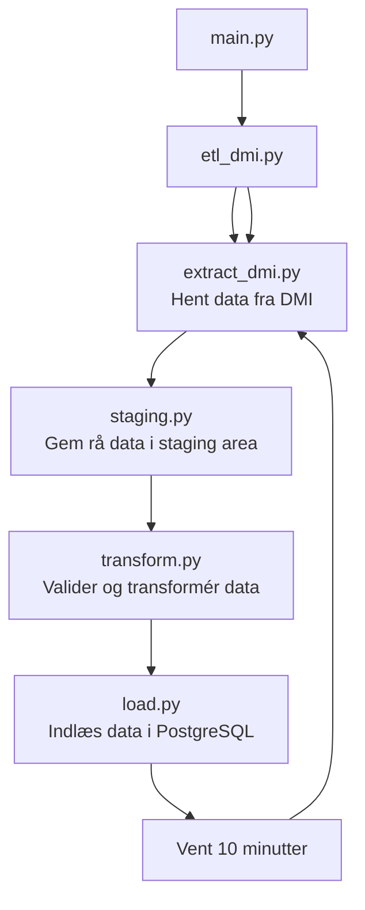
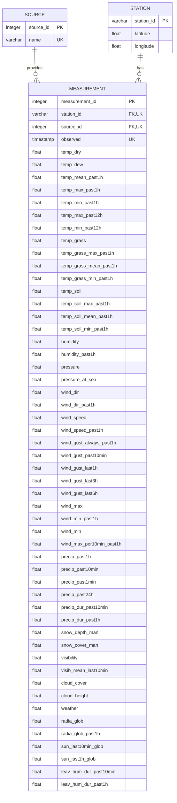

# Opgave 2 - Indsamling af miljødata

## Beskrivelse af projektet
Formålet med dette projekt er at indsamle og strukturere miljødata, som kan anvendes til at vurdere kvaliteten af det fysiske arbejdsmiljø. Projektet anvender vejrdata fra DMIs offentlige API og gemmer dataen i en PostgreSQL-database. Dataen behandles gennem en ETL-pipeline, hvor de først hentes fra API'en, gemmes i et staging area, valideres og transformeres til projektets datastruktur og til sidst indlæses i databasen.

## Beskrivelse af, hvordan projektet bygges, køres og testes
Projektet er udviklet i Python og køres ved hjælp af Docker og Docker Compose. Docker sørger for, at applikationen og PostgreSQL-databasen kan køre i separate containere med de nødvendige afhængigheder.

Før projektet bygges og køres, skal der oprettes en `.env`-fil i projektets root-mappe. Filen skal indeholder:
```text
POSTGRES_DB=postgres_db
POSTGRES_USER=admin
POSTGRES_PASSWORD=password
POSTGRES_HOST=db
POSTGRES_PORT=5432
PGADMIN_USER_EMAIL=admin@example.com
PGADMIN_PASSWORD=password
```
`POSTGRES_HOST=db` og `POSTGRES_PORT=5432` skal ikke ændres, da de bruges til forbindelsen mellem Docker-containerne. De øvrige værdier kan vælges af brugeren. Disse værdier skal bruges, når der oprettes forbindelse til databasen og pgAdmin. `.env`-filen indeholder loginoplysninger og skal derfor ikke pushes til GitHub og er inkluderet i `.gitignore`.

Projektet indeholder en pgAdmin-container, som kan bruges til at se og arbejde med PostgreSQL-databasen. pgAdmin startes med kommandoen `docker compose up -d pgadmin`. Derefter åbnes http://localhost:8080/ i en browser. Log ind med email og password fra `.env`-filen (`PGADMIN_USER_EMAIL` og `PGADMIN_PASSWORD`). Når forbindelsen til PostgreSQL åbnes bliver brugeren bedt om et password. Her bruges værdien for `POSTGRES_PASSWORD` fra `.env`-filen. 

### Byg projektet
Projektets Docker-image bygges med kommandoen `docker compose build app`.
Kommandoen bygger applikationens Docker-image ud fra projektets Dockerfile og installerer de nødvendige Python-pakker.

### Kør projektet
Programmet køres ved først at starte PostgreSQL-databasen med kommandoen `docker compose up -d db`. Derefter startes applikationen med `docker compose run --build --rm app`. Når programmet startes, køres databasemigrationer, så databasen oprettes eller opdateres med de nødvendige tabeller. ETL-pipelinen henter herefter vejrdata fra DMIs API for de seneste 10 minutter. De rå data gemmes først i et staging area i PostgreSQL-databasen, hvor de opbevares i deres oprindelige format sammen med metadata om dataindsamlingen og behandlingens status. Herefter hentes dataene fra staging area, valideres og transformeres til projektets format, inden de indlæses i de relevante tabeller i databasen. Staging area gør det muligt at genoptage behandlingen af gemte data, hvis der opstår fejl under transformation eller indlæsning, uden at dataene nødvendigvis skal hentes igen fra DMIs API. For hver batch registreres behandlingens status, så det er muligt at holde styr på, om dataene afventer behandling, er under behandling, er fejlet eller er gennemført. Programmet fortsætter med at hente og behandle nye data hvert 10. minut, så længe det kører.

### Test projektet
Programmet testes med enhedstest ved hjælp af pakken `pytest`. Projektets tests køres med kommandoen `docker compose run --build --rm tests`. Testene kontrollerer blandt andet, at data bliver transformeret og indlæst korrekt, samt at de forskellige dele af ETL-processen fungerer. Testenes code coverage bliver samtidig vist. 

## Beskrivelse af den implementerede softwarearkitektur
Projektet er opbygget som en ETL-pipeline, hvor data først hentes fra DMIs offentlige API og gemmes i et staging area. Herefter transformeres dataene til projektets datastruktur og indlæses til sidst i en PostgreSQL-database. 

`main.py` fungerer som programmets hovedfil og starter databaseopsætningen samt ETL processen.

`database.py` indeholder funktioner til at oprette forbindelse til PostgreSQL og til at oprette eller finde en datakilde i source-tabellen.

Databasens struktur oprettes og versionsstyres ved hjælp af database migrationer. `migrations.py` håndterer databasemigrationer. Systemet registrerer gennemførte migrationer i en tabel og sikrer, at de ikke køres igen. Fremtidige ændringer af databasestrukturen implementeres som nye SQL-migrationsfiler, der automatisk anvendes af migrationssystemet.

ETL-processen er delt op i flere filer med hvert sit ansvar:
- `extract_dmi.py` henter data fra DMI's API.
- `staging.py` gemmer de rå data i et staging area i PostgreSQL-databasen og håndterer hentning af batches samt opdatering af deres behandlingstatus.
- `transform.py` validerer og omdanner dataene fra staging area til et ensartet format, som passer til projektets databasestruktur.
- `load.py` indsætter de transformerede data i PostgreSQL-databasen.
- `etl_dmi.py` styrer hele ETL-processen.

ETL-pipelinen håndterer midlertidige forbindelsesfejl med automatisk genforsøg og ventetid, så behandlingen kan fortsætte, når forbindelsen er genetableret.

## UML-diagram


## ER diagram over databasestrukturen


## REST API
Projektet indeholder en REST API udviklet med FastAPI, som giver adgang til miljødataen indsamlet fra DMI og gemt i PostgreSQL-databasen. API'en startes fra projektets rodmappe ved at køre kommandoen `docker compose up --build api`. Når API'en er startet, er den tilgængelig lokalt på http://localhost:8000. Den interaktive dokumentation kan tilgås via http://localhost:8000/docs, hvor det er muligt at se de tilgængelige endpoints, afprøve forespørgsler og se de returnerede data. For at API'ens data-endpoints kan anvendes, skal PostgreSQL-databasen være tilgængelig, og de nødvendige databasetabeller skal være oprettet. 

API'en har følgende endpoints:
- GET `/health`: Kontrollerer, om API'en svarer.
- GET `/stations`: Henter alle målestationer fra databasen.
- GET `/stations/{station_id}`: Henter oplysninger om en bestemt målestation ud fra dens ID.
- GET `/sources`: Henter alle datakilder fra databasen.
- GET `/measurements`: Henter målinger fra databasen med mulighed for at filtrere efter målestation, datakilde og tidspunkt.

Endpointet `/measurements` kan filtreres med følgende query-parametre:
- `station_id`: Filtrerer efter målestation.
- `source_id`: Filtrerer efter datakilde.
- `start_time`: Angiver det tidligste observationstidspunkt.
- `end_time`: Angiver det seneste observationstidspunkt.
- `limit`: Begrænser antallet af returnerede målinger til mellem 1 og 100. Hvis der ikke angives en værdi for limit, returneres 100 målinger.

Parametrene kan kombineres i samme forespørgsel.

### Eksempel på et API-kald
Følgende forespørgsel henter op til 50 målinger fra målestation 06033 i tidsrummet 15. oktober 2026 kl. 08:00 - 09:00:

`GET /measurements?station_id=06033&start_time=2026-10-15T08:00:00Z&end_time=2026-10-15T09:00:00Z&limit=50`.

Forespørgslen kan udføres i en browser: 
http://localhost:8000/measurements?station_id=06033&start_time=2026-10-15T08:00:00Z&end_time=2026-10-15T09:00:00Z&limit=50

API'en returnerer de matchende målinger i JSON-format. Hvis ingen målinger matcher filtrene, returneres en tom liste.


