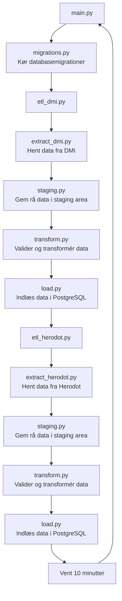
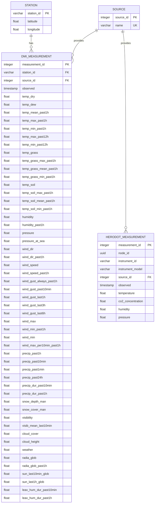

# Opgave 2 - Indsamling af miljødata

## Beskrivelse af projektet
Formålet med dette projekt er at indsamle, strukturere og analysere miljødata, som kan anvendes til at vurdere kvaliteten af det fysiske arbejdsmiljø. Projektet henter vejrdata fra DMIs offentlige API samt miljømålinger fra Herodot API'et, som måler forholdene på kontoret. Dataene behandles gennem separate ETL-pipelines, hvor de hentes, gemmes i et staging area, valideres og transformeres til projektets datastruktur, inden de indlæses i en PostgreSQL-database. Projektet indeholder desuden en lokal REST API, som gør det muligt at tilgå data fra databasen. 

## Beskrivelse af, hvordan projektet bygges, køres og testes
Projektet er udviklet i Python og køres ved hjælp af Docker og Docker Compose. Docker sørger for, at applikationen og PostgreSQL-databasen kan køre i separate containere med de nødvendige afhængigheder.

Før projektet bygges og køres, skal der oprettes en `.env`-fil i projektets root-mappe. Filen skal indeholder:
```text
POSTGRES_DB=postgres_db
POSTGRES_USER=admin
POSTGRES_PASSWORD=password
POSTGRES_HOST=db
POSTGRES_PORT=5432
PGADMIN_USER_EMAIL=admin@example.com
PGADMIN_PASSWORD=password

HERODOT_API_TOKEN = api_token
```
`POSTGRES_HOST=db` og `POSTGRES_PORT=5432` skal ikke ændres, da de bruges til forbindelsen mellem Docker-containerne. 

Erstat `api_token` med det gyldige API-token til Herodot (https://herodot.spac.dk/). Tokenet bruges af Herodot ETL-processen til at godkende forespørgsler til API'en. 

De øvrige værdier kan vælges af brugeren. Disse værdier skal bruges, når der oprettes forbindelse til databasen og pgAdmin. `.env`-filen indeholder loginoplysninger og skal derfor ikke pushes til GitHub og er inkluderet i `.gitignore`.

Projektet indeholder en pgAdmin-container, som kan bruges til at se og arbejde med PostgreSQL-databasen. pgAdmin startes med kommandoen `docker compose up -d pgadmin`. Derefter åbnes http://localhost:8080/ i en browser. Log ind med email og password fra `.env`-filen (`PGADMIN_USER_EMAIL` og `PGADMIN_PASSWORD`). Når forbindelsen til PostgreSQL åbnes bliver brugeren bedt om et password. Her bruges værdien for `POSTGRES_PASSWORD` fra `.env`-filen. 

### Byg projektet
Projektets Docker-image bygges med kommandoen `docker compose build app`.
Kommandoen bygger applikationens Docker-image ud fra projektets Dockerfile og installerer de nødvendige Python-pakker.

### Kør projektet
Programmet køres ved først at starte PostgreSQL-databasen med kommandoen `docker compose up -d db`. Derefter startes applikationen med `docker compose run --build --rm app`. Når programmet startes, køres databasemigrationer, så databasen oprettes eller opdateres med de nødvendige tabeller. ETL-pipelinen henter herefter vejrdata fra DMIs API og målinger fra Herodot API'en for de seneste 10 minutter. De rå data gemmes først i et staging area i PostgreSQL-databasen, hvor de opbevares i deres oprindelige format sammen med metadata om dataindsamlingen og behandlingens status. Herefter hentes dataene fra staging area, valideres og transformeres til projektets format, inden de indlæses i de relevante tabeller i databasen. Staging area gør det muligt at genoptage behandlingen af gemte data, hvis der opstår fejl under transformation eller indlæsning, uden at dataene nødvendigvis skal hentes igen fra DMIs API. For hver batch registreres behandlingens status, så det er muligt at holde styr på, om dataene afventer behandling, er under behandling, er fejlet eller er gennemført. Programmet fortsætter med at hente og behandle nye data hvert 10. minut, så længe det kører.

### Test projektet
Programmet testes med enhedstest ved hjælp af pakken `pytest`. Projektets tests køres med kommandoen `docker compose run --build --rm tests`. Testene kontrollerer blandt andet, at data bliver transformeret og indlæst korrekt, samt at de forskellige dele af ETL-processen fungerer. Testenes code coverage bliver samtidig vist. 

## Beskrivelse af den implementerede softwarearkitektur
Projektet er opbygget som en ETL-pipeline, hvor data først hentes fra DMIs offentlige API og gemmes i et staging area. Herefter transformeres dataene til projektets datastruktur og indlæses til sidst i en PostgreSQL-database. 

`main.py` fungerer som programmets hovedfil og starter databaseopsætningen samt ETL processen.

`database.py` indeholder funktioner til at oprette forbindelse til PostgreSQL og til at oprette eller finde en datakilde i source-tabellen.

Databasens struktur oprettes og versionsstyres ved hjælp af database migrationer. `migrations.py` håndterer databasemigrationer. Systemet registrerer gennemførte migrationer i en tabel og sikrer, at de ikke køres igen. Fremtidige ændringer af databasestrukturen implementeres som nye SQL-migrationsfiler, der automatisk anvendes af migrationssystemet.

ETL-processen er delt op i flere filer med hvert sit ansvar:
- `extract_dmi.py` henter data fra DMI's API.
- `extract_herodot.py` henter data fra herodot API'en.
- `staging.py` gemmer de rå data i et staging area i PostgreSQL-databasen og håndterer hentning af batches samt opdatering af deres behandlingstatus.
- `transform.py` validerer og omdanner dataene fra staging area til et ensartet format, som passer til projektets databasestruktur.
- `load.py` indsætter de transformerede data i PostgreSQL-databasen.
- `etl_dmi.py` styrer ETL-processen for DMI dataen.
- `etl_herodot.py` styrer ETL-processen for herodot dataen.

ETL-pipelinen håndterer midlertidige forbindelsesfejl med automatisk genforsøg og ventetid, så behandlingen kan fortsætte, når forbindelsen er genetableret.

## UML-diagram
Nedenstående UML-diagram viser projektets overordnede struktur og sammenhængen mellem de forskellige komponenter i systemet.



## ER diagram over databasestrukturen
Nedenstående ER diagram viser strukturen over databasen, som består af fire tabeller: `source`, `station`, `dmi_measurement`, `herodot_measurement`. Tabellen `source` indeholder oplysninger om datakilderne, `station` indeholder oplysninger om DMI's målestationer, `dmi_measurement` indeholder vejrdata fra DMI, og `herodot_measurement` indeholder målinger fra Herodot.



## REST API
Projektet indeholder en REST API udviklet med FastAPI, som giver adgang til miljødataen indsamlet fra DMI og Herodot gemt i PostgreSQL-databasen. API'en startes fra projektets rodmappe ved at køre kommandoen `docker compose up --build api`. Når API'en er startet, er den tilgængelig lokalt på http://localhost:8000. Den interaktive dokumentation kan tilgås via http://localhost:8000/docs, hvor det er muligt at se de tilgængelige endpoints, afprøve forespørgsler og se de returnerede data. For at API'ens data-endpoints kan anvendes, skal PostgreSQL-databasen være tilgængelig, og de nødvendige databasetabeller skal være oprettet. 

API'en har følgende endpoints:
- GET `/`: Returnere en velkomstbesked.
- GET `/health`: Kontrollerer, om API'en svarer.
- GET `/sources`: Henter alle datakilder fra databasen.
- GET `/dmi/stations`: Henter alle målestationer fra databasen.
- GET `/dmi/stations/{station_id}`: Henter oplysninger om en bestemt målestation ud fra dens ID.
- GET `/measurements`: Henter målinger fra både DMI og Herodot med mulighed for at filtrere efter datakilde og tidspunkt.
- GET `/dmi/measurements`: Henter målinger fra DMI med mulighed for at filtrere efter station og tidspunkt.
- GET `herodot/measurements`: Henter målinger fra Herodot med mulighed for at filtrere efter node, instrument id, instrument model og tidspunkt.

Endpointet `/measurements` kan filtreres med følgende query-parametre:
- `source_id`: Filtrerer efter datakilde.
- `start_time`: Angiver det tidligste observationstidspunkt.
- `end_time`: Angiver det seneste observationstidspunkt.
- `limit`: Begrænser antallet af returnerede målinger til mellem 1 og 100. Hvis der ikke angives en værdi for limit, returneres 100 målinger.

Endpointet `/dmi/measurements` kan filtreres med følgende query-parametre:
- `station_id`: Filtrerer efter målestation.
- `start_time`: Angiver det tidligste observationstidspunkt.
- `end_time`: Angiver det seneste observationstidspunkt.
- `limit`: Begrænser antallet af returnerede målinger til mellem 1 og 100. Hvis der ikke angives en værdi for limit, returneres 100 målinger.

Endpointet `/herodot/measurements` kan filtreres med følgende query-parametre:
- `node_id`: Filtrerer efter node. 
- `instrument_id`: Filtrerer efter instrument id.
- `instrument_model`: Filtrerer efter instrument model.
- `start_time`: Angiver det tidligste observationstidspunkt.
- `end_time`: Angiver det seneste observationstidspunkt.
- `limit`: Begrænser antallet af returnerede målinger til mellem 1 og 100. Hvis der ikke angives en værdi for limit, returneres 100 målinger.

Parametrene kan kombineres i samme forespørgsel.

### Eksempel på et API-kald
Følgende forespørgsel henter op til 50 målinger fra DMI for målestation 06033 i tidsrummet 15. oktober 2026 kl. 08:00 - 09:00:

`GET /dmi/measurements?station_id=06033&start_time=2026-10-15T08:00:00Z&end_time=2026-10-15T09:00:00Z&limit=50`.

Forespørgslen kan udføres i en browser: 
http://localhost:8000/dmi/measurements?station_id=06033&start_time=2026-10-15T08:00:00Z&end_time=2026-10-15T09:00:00Z&limit=50

API'en returnerer de matchende målinger i JSON-format. Hvis ingen målinger matcher filtrene, returneres en tom liste.

## Visualiseringer af DMI data
Projektet indeholder filer, som visualiserer data fra PostgreSQL-databasen hentet fra DMI's API. Visualiseringerne kan bruges til at undersøge variationer, mulige sammenhænge og forskelle mellem målestationer.

### Temperatur
- Temperatur over tid for én station: Viser, hvordan temperaturen ændre sig over tid for en bestemt målestation samt den gennemsnitlige temperatur for stationen.
- Sammenligning af temperatur over tid af flere stationer: Gør det muligt at sammenligne temperaturudviklingen mellem udvalgte målestationer.
- Gennemsnitlig temperatur på tværs af stationer: Sammenligner stationernes gennemsnitstemperatur og viser forskelle mellem målestationerne.
- Boxplot af temperaturfordelingen på tværs af stationer: Viser median, spredning og mulige ekstreme temperaturmålinger for hver målestation.

### Vindhastighed
- Vindhastighed over tid for én station: Viser, hvordan vindhastigheden varierer over tid samt den gennemsnitlige vindhastighed for en bestemt målestation.
- Sammenligning af vindhastighed over tid for flere stationer: Sammenligner vindhastighedens udvikling mellem udvalgte målestationer.
- Gennemsnitlig vindhastighed på tværs af stationer: Giver et overblik over forskelle i den gennemsnitlige vindhastighed mellem målestationerne.

### Luftfugtighed
- Luftfugtighed over tid for én station: Viser, hvordan luftfugtigheden ændrer sig over tid samt den gennemsnitlige luftfugtighed for en bestemt målestation.
- Sammenligning af luftfugtighed over tid for flere stationer: Sammenligner luftfugtighedens udvikling mellem udvalgte målestationer.
- Gennemsnitlig luftfugtighed på tværs af stationer: Viser forskelle i den gennemsnitlige luftfugtighed mellem målestationerne.

### Sammenhæng mellem vejrparametre
- Temperatur vs. vindhastighed over tid for én station: Sammenligner, hvordan temperatur og vindhastighed ændre sig over tid for en bestemt målestation.
- Temperatur vs. vindhastighed - korrelation for alle stationer: Viser, om der er en statistisk sammenhæng mellem temperatur og vindhastighed på tværs af målestationerne.
- Temperatur vs. luftfugtighed over tid for en station: Sammenligner, hvordan temperatur og luftfugtighed ændre sig over tid for en bestemt målestation.
- Temperatur vs. luftfugtighed - korrelation for alle stationer: Viser, om temperatur og luftfugtighed har en statistisk sammenhæng på tværs af målestationerne.
- Korrelationsheatmap mellem udvalgte vejrparametre: Samler korrelationerne mellem flere vejrparametre i en figur. Positive og negative korrelationer kan bruges til at identificere mulige sammenhænge.

Et visualiseringsscript kan eksempelvis køres med kommandoen `docker compose run --rm app python -m visualizations.temperature_boxplot`. De genererede grafer gemmes i en outputmappe `plots`. 

### Eksempler på visualiseringer
Nedenfor vises et udvalg af projektet visualiseringer. De illustrerer, hvordan vejrdata fra PostgreSQL-databasen kan bruges til at undersøge temperaturudviklingen, sammenligne målestationer og analysere sammenhænge mellem vejrparametre. De øvrige visualiseringer kan genereres ved at køre de tilhørende scripts. De visualiserede data er indsamlet fra DMI's API i perioden fra den 7. oktober 2026 til den 23. oktober 2026.

**Temperatur over tid for stationen 06108**


Grafen viser temperaturmålingerne over tid samt den gennemsnitlige temperatur for målestationen 06108.

**Sammenligning af temperatur for tre stationer**


Grafen sammenligner temperaturudviklingen for målestationerne 06108, 06110 og 06120. Grafen viser, at der er små forskelle i temperatur mellem de tre stationer, men at temperaturerne generelt følger det samme mønster over tid. 

**Gennemsnitlig temperatur på tværs af stationer**


Grafen viser den gennemsnitlige temperatur på tværs af alle målestationer. Grafen viser, at der er stor forskel i gennemsnitstemperaturen mellem stationerne. Nogle stationer har temperatur helt ned omkring -18 °C, mens andre ligger op omkring 13 °C. Det viser, at temperaturen varierer meget mellem målestationerne.

**Boxplot af temperaturfordelingen på tværs af stationer**


Boxplottet viser temperaturfordelingen på tværs af alle målestationer. Nogle stationer har en lille spredning i temperaturmålingerne, mens andre har en større spredning og flere outliers. Det viser, at der er forskelle i temperaturvariation mellem stationerne.

**Temperatur vs. vindhastighed på tværs af stationer**


Grafen viser sammenhængen mellem temperatur og vindhastighed på tværs af alle målestationer. Pearsons korrelationskoefficient er anvendt til at undersøge, om der er en positiv eller negativ sammenhæng mellem de to parametre. Nogle stationer har positiv korrelation, hvilket betyder, at temperaturen og vindhastigheden har tendens til at stige sammen. Andre stationer har en negativ korrelation, hvilket betyder, at temperaturen har tendens til at falde, når vindhastigheden stiger, og omvendt. Enkelte stationer har korrelation tæt på 0, hvilket betyder, at der ikke er nogen tydelig lineær sammenhæng mellem temperatur og vindhastighed. 

Antallet af målinger varierer mellem stationerne, og nogle stationer har kun få målinger. Det kan påvirke, hvor pålidelig korrelationen er, da få målinger reducerer pålideligheden af vurderingen af korrelationen mellem temperatur og vindhastighed. 

**Korrelationsheatmap mellem udvalgte vejrparametre**


Heatmappet viser korrelationer mellem vejrparametrene: lufttemperatur, dugpunktstemperatur, luftfugtighed, lufttryk, vindhastighed, nedbør de seneste 10 minutter, sigtbarhed, skydække og globalstråling. Pearsons korrelationskoefficient er anvendt til at måle den lineære sammenhæng mellem parametrene. Farverne viser, om der er en positiv eller negativ sammenhæng mellem parametrene, og hvor stærk sammenhængen er. For eksempel er der en positiv korrelation mellem lufttemperatur og dugpunktstemperatur, hvilket betyder, at de to parametre har tendens til at stige sammen. Der er derimod en negativ korrelation mellem skydække og globalstråling, hvilket viser en tendens til, at højere globalstråling hænger sammen med mindre skydække. 

## Visualiseringer af DMI vs. Herodot data
Projektet indeholder også visualiseringer, der sammenligner vejrdata hentet fra DMI's API med indendørs miljødata hentet fra Herodot API'en. Visualiseringerne kan bruges til at undersøge forskelle og mulige sammenhænge mellem udendørs- og indendørsforhold, herunder temperatur og luftfugtighed. 

For at gøre sammenligningen mere relevant er DMI-dataene filtreret, så kun målestationer i Danmark indgår, da Herodot-målingerne er foretaget i Danmark. DMI-målingerne repræsenterer dog udendørsforhold på tværs af danske målestationer og ikke forholdene lige uden for Herodot-sensorerne. 

Følgende visualiseringerne illustrerer, hvordan dataen fra PostgreSQL-databasen kan bruges til at sammenligne udendørs- og indendørsforhold. De visualiserede data er indsamlet fra DMI's API og Herodot API'en i perioden fra den 28. oktober 2026 til den 30. oktober 2026.

**Temperatur - DMI vs. Herodot**


Grafen viser temperaturudviklingen over tid for DMI og Herodot. Grafen viser, at temperaturen indendørs er højere end temperaturen udendørs. Samtidig ses der en tendens til, at temperaturændringerne udendørs afspejles i temperaturen indendørs. Når udendørstemperaturen stiger eller falder, er der en lignende udvikling i indendørstemperaturen. Dette viser, at udendørstemperaturen har betydning for temperaturudviklingen indendørs. 

**Luftfugtighed - DMI vs. Herodot**


Grafen viser luftfugtigheden over tid for DMI vs. Herodot. Grafen viser, at luftfugtigheden udendørs er højere end indendørs. Der kan ses en tendens til, at luftfugtigheden udendørs og indendørs følger et lignende mønster over tid. Når luftfugtigheden udendørs stiger eller falder, ses der en tilsvarende udvikling indendørs. Dette viser, at luftfugtigheden udendørs har betydning for udviklingen af luftfugtigheden indendørs.

**Boxplot - temperaturfordeling**


Boxplottet sammenligner temperaturfordelingen for DMI og Herodot. Plottet viser, at temperaturen er højere indenfor end udendørs. Samtidig har indendørstemperaturen en større spredning og flere outliers. Dette indikerer, at temperaturen varierer mere indendørs.

**Korrelationsheatmap**


Heatmappet viser Pearson-korrelationerne mellem temperatur og luftfugtighed fra DMI og Herodot. Farverne og korrelationsværdierne viser, om der er en positiv eller negativ sammenhæng mellem parametrene, og hvor stærk sammenhængen er. For eksempel er der en positiv korrelation mellem DMI-temperaturen og Herodot-temperaturen, hvilket indikerer en positiv lineær sammenhæng. Det betyder, at en højere udendørstemperatur fører til en stigning i indendørstemperaturen. Der er derimod en negativ korrelation mellem Herodot-temperaturen og Herodot-luftfugtigheden. Det indikerer, at højere indendørstemperaturer fører til lavere indendørs luftfugtighed.

